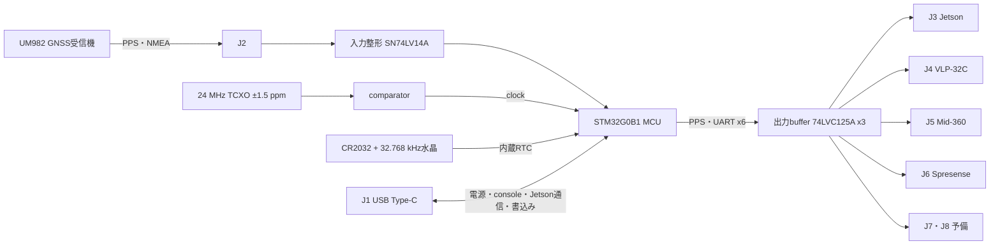

# GPSタイミング同期インターフェース基板

ロボットに載せた各機器の時刻を、GNSS（GPS）の時刻へそろえるための基板。外付けのGNSS受信機UM982から1秒パルス（PPS）と時刻の文（NMEAのRMC）を受け、Jetson Orin Nano、LiDAR（Velodyne VLP-32C、Livox Mid-360）、Spresense（IMU）へ、それぞれが受け取れる形でPPSとNMEAを配る。GNSSが見えなくなっても、基板上の高安定な発振器（TCXO）と電池で保持する時計（RTC）で出力を続ける。

## 現在の状態（2026-10-17）

- 初回試作（60 × 38 mm、4層、部品は表面だけ、取付穴なし）を2026-09-06にJLCPCBへ発注し、2026-10-03から2枚で試験している。
- 確認できたこと: USB接続（console用とJetson通信用の2ポート）、PCからの時刻設定、USBを抜き差ししたあとのRTCからの時刻復帰、屋外でのGNSSへの同期（GNSS PPSとの位相差は標準偏差20 ns、最大62 ns）、6系統へのPPS・RMC出力。
- まだ確かめていないこと: 接続先の各機器での受信（Jetson、VLP-32C、Mid-360、Spresense）、GNSSを失ってから5分間の時刻誤差1 ms以下（要求R-013）、長時間の連続動作。
- 知っておくべき制約:
  - 基板のBOOTボタン（SW2）+RESETボタン（SW1）では書込みモード（DFU）に入れない。MCUの設定（option byte）を出荷時のままにしているため。書込みはconsoleの`dfu` commandかSWDで行う。
  - firmwareにはwatchdogがまだない。2026-10-10に1回、USBが応答しなくなり電源の入れ直しで戻った（原因は未特定）。
  - 設計書の一部（基板外形75 × 50 mm・2層など）は当初の設計値で、発注版と違う。違いは各文書に注記した。
- 既知の問題と未決事項は[`hardware/overall/open_issues.md`](hardware/overall/open_issues.md)にある。

## しくみ

- **PPSはいつもMCUのtimerが作る。** GNSSのPPSをそのまま中継するのではなく、TCXOで動く32-bit timer（TIM2、48 MHz）の周期をGNSSのPPSに合わせて調整し（DPLL）、そのtimerがPPSを出す。GNSSを失っても同じtimerが学習済みの補正値でPPSを出し続ける（holdover）。
- **時刻源の優先順位はGNSS、Jetson、RTCの順。** GNSSがあればGNSSに同期する。なければJetson（またはPC）からUSB経由で与えた時刻、それもなければ電池で保持した内蔵RTCの時刻で動く。
- **時刻が確かでないあいだは出力しない。** 起動直後やclockの異常時は、全出力をHigh-Z（何も駆動しない状態）にする。GNSSに戻ったときにずれが大きい場合も、一度High-Zにしてから時刻を合わせ直す。
- **GNSSがない間は、RMCのstatusを`V`（無効）にして送る。** 時刻は出し続けるが、測位が有効だとは偽らない。
- **出力は接続先ごとに独立している。** 6系統のUARTとbufferを別々に持ち、送信内容、速度、出力のon/offを個別に制御する。VLP-32C向けは信号を論理反転し、時刻を1秒進めて送る（VLP-32Cの仕様）。
- 外部機器へは給電しない。全信号は3.3 V。基板の電源はUSB Type-Cの5 Vだけ。

## コネクタ

信号コネクタはGH互換（1.25 mm pitch、CJT A1257シリーズ）。pin 1はすべてGND。抜き差しは全機器の電源を切った状態で行う。

| Ref | 接続先 | 極数 | pin 1 | pin 2 | pin 3 | pin 4 |
|---|---|---:|---|---|---|---|
| J1 | PC / Jetson（USB Type-C） | — | 電源（5 V）とUSB 2.0 | | | |
| J2 | UM982（入力） | 3 | GND | PPS入力 | NMEA入力 | |
| J3 | Jetson（中継基板経由） | 4 | GND | PPS出力 | NMEA出力 | 受信（運用では使わない） |
| J4 | VLP-32C | 3 | GND | PPS出力 | NMEA出力（反転、+1秒） | |
| J5 | Mid-360 | 3 | GND | PPS出力 | NMEA出力 | |
| J6 | Spresense用レベル変換基板 | 3 | GND | PPS出力 | NMEA出力 | |
| J7 | 予備1 | 4 | GND | PPS出力 | UART送信 | UART受信 |
| J8 | 予備2 | 4 | GND | PPS出力 | UART送信 | UART受信 |

NMEAはGPRMC、9600 baud、8N1、PPSの立上りから200 ms後に送る。PPSのHigh幅は100 msで、立上りが秒の境界。Jetsonとの時刻設定・状態確認はJ3ではなくUSBで行う（[`hardware/overall/jetson_time_protocol.md`](hardware/overall/jetson_time_protocol.md)）。

## 主要部品

| 役割 | 部品 |
|---|---|
| MCU | STMicroelectronics STM32G0B1RCT6（Cortex-M0+、LQFP-64） |
| 基準clock | YXC OW7EL89CENUYO3YLC-24M（24 MHz TCXO、±1.5 ppm）+ TI LMV7219（CMOS化） |
| RTC | MCU内蔵RTC + 32.768 kHz水晶（SC-32S）+ CR2032（電池は手で入れる） |
| 3.3 V電源 | TI TPS70933（LDO） |
| 入力整形 | TI SN74LV14A（Schmitt inverter） |
| 出力buffer | 74LVC125A x3（12出力を個別にenable） |
| USB保護 | USBLC6-2SC6 |

## ファイルの案内

| 場所 | 内容 |
|---|---|
| [`hardware/rev1/`](hardware/rev1/) | 発注した初回試作の回路図PDF、PCB図、BOM（EasyEDA Proの出力） |
| [`plan/design.md`](plan/design.md) | 設計書。要求、接続先ごとの信号仕様、回路の考え方、検証の合否条件 |
| [`hardware/overall/`](hardware/overall/) | ピン割当、時刻源の状態遷移、Jetsonとの通信仕様、消費電流、ハーネス、未決事項 |
| [`firmware/`](firmware/) | MCUのfirmware（C、CMake）と書込み・試験用のPython script。buildと使い方は[`firmware/README.md`](firmware/README.md) |

## このリポジトリについて

公開リポジトリ[CoderDojoMusashikosugi/cub_2026_timing_sync_if_board](https://github.com/CoderDojoMusashikosugi/cub_2026_timing_sync_if_board)は、開発用の非公開リポジトリから、回路の設計情報とfirmwareだけを写したものである（写す範囲は非公開側の`tools/public_paths.txt`で決めている）。変更は非公開側で行い、公開側へは直接pushしない。気づいたことは公開側のIssueで知らせてほしい。

文書の中には、公開側に含めていない資料へのリンクや、非公開の決定記録の番号（`DR-0xx`）が残っている。含めていないのは、検討記録（`plan/considerations.md`）、レビュー記録（`hardware/reviews/`、`hardware/sch_reviews/`、`pcb_review/`）、レイアウト前の指針（`hardware/overall/pcb_layout_guidelines.md`）、メーカー資料（`hardware/datasheets/`）、試験ログ（`firmware/test_results/`）である。公開側でリンク先が開けないのはそのためである。

## ライセンス

[MIT License](LICENSE)。`firmware/third_party/`の外部sourceは、それぞれのLICENSEに従う（CMSIS: Apache-2.0、TinyUSB: MIT）。
