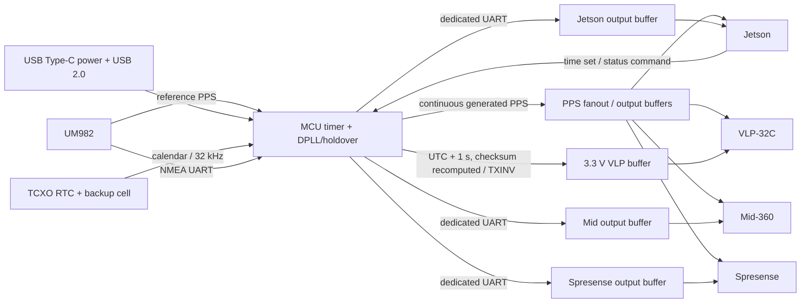

# GPSタイミング同期インターフェース基板 設計書

- 文書状態: 回路設計ベースライン確定 / 機構条件と実機検証結果待ち
- 更新日: 2026-08-11
- 文書版: 0.22
- 製造先: JLCPCB PCBA
- EDA: EasyEDA Pro
- 文書種別: 最終設計の正本。検討経緯は[`considerations.md`](./considerations.md)、現在の未解決事項は[`../hardware/overall/open_issues.md`](../hardware/overall/open_issues.md)に分離する
- 最新レビュー: [`../hardware/reviews/pre_easyeda_design_review.md`](../hardware/reviews/pre_easyeda_design_review.md)（版0.22はDR-012～DR-030を反映）
- メーカー一次資料: [`../hardware/datasheets/`](../hardware/datasheets/)

## 1. 目的

外部UM982モジュールを基準時刻源とし、PPSおよびNMEA時刻情報をJetson Orin Nano、VLP-32C、Mid-360、Spresense向けレベルシフト基板へ配信する。GNSS信号消失時はJetson、さらにJetsonが使用できない場合はバッテリバックアップ付きRTCへ切り替え、PPS/NMEAの出力を継続する。

## 2. 確定要求

| ID | 要求 | 状態 |
|---|---|---|
| R-001 | UM982のPPS/NMEAを各接続機器へ配信する | 確定 |
| R-002 | VLP-32C向けUART信号は論理反転する | 確定 |
| R-003 | VLP-32C向けNMEAの時刻は、元の時刻に対して1秒進める | 確定 |
| R-004 | GNSS信号消失時、MCUからPPS/NMEAを出力できる | 確定 |
| R-005 | JLCPCB PCBAを使用し、低コストを優先する | 確定 |
| R-006 | Basic Parts / Promotional Partsを可能な限り優先する | 確定 |
| R-007 | UM982は外部モジュールとし、GHコネクタ経由でPPS/NMEAを入力する | 確定 |
| R-008 | Jetson Orin Nano公式Developer Kitの40-pin headerへ接続する | 確定 |
| R-009 | Spresenseのレベルシフトは別基板で行い、本基板のスコープ外とする | 確定 |
| R-010 | Jetsonからデバッグ用時刻を受信し、基板時刻とRTCを初期化できる | 確定 |
| R-011 | 時刻源の優先順位をGNSS、Jetson、RTCの順とする | 確定 |
| R-012 | Jetsonがなくても妥当な日時で起動できるよう、バックアップ電源付きRTCを搭載する | 確定 |
| R-013 | GNSS消失後5分間の時刻誤差を1 ms以下とする | 確定 |
| R-014 | 基板電源はUSB Type-Cから供給する | 確定 |
| R-015 | USB Type-CをMCUのデバッグコンソールおよびファームウェア更新にも使用する | 確定 |
| R-016 | 外部UM982へ本基板から給電しない | 確定 |
| R-017 | Jetson、VLP-32C、Mid-360、Spresense向けTXをMCUから個別に制御する | 確定 |
| R-018 | MCUの個別UART TX/RXおよびPPSを配線した予備GHコネクタを2個設ける | 確定 |

## 3. インターフェース仕様

### 3.1 UM982

- 電源は3.0～3.6 V、標準3.3 V。代表動作電流180 mA、最大300 mA。
- I/Oは3.3 V系。出力条件は2 mA時にLow最大0.45 V、High最小 `VCC - 0.45 V`。
- 3 UARTと1 PPSを持つ。
- UM982自体は本基板へ実装せず、外部モジュールからPPS/NMEA/GNDをGHコネクタで受ける。
- 現在の前提ではUM982への電源供給は行わない。給電も必要な場合はコネクタと電源回路を変更する。

資料: [UM982 User Manual R1.7](https://www.unicorecomm.com/assets/UM982_User_Manual_R1.7/index.html)

### 3.2 VLP-32C

- GPS入力はPPSと、NMEA GPRMCまたはGPGGAを使用する。
- 入力Highは3.0 V超～5.0 V未満、Lowは1.2 V未満。High時に2 mA以上を供給できること。
- UARTから直接出した通常極性ではなく、反転したシリアル信号を要求する。
- NMEA完了から次のPPS立上りまで300 ms以上、PPS立下りから次のNMEA開始まで50 ms以上が必要。
- したがって、VLP-32C向けNMEAは次のPPSに対応するUTC時刻へ+1秒し、チェックサムも再計算する。

資料: [VLP-32C User Manual](https://data.ouster.io/downloads/velodyne/user-manual/vlp-32c-revd-user-manual.pdf)

### 3.3 Mid-360

- PPSとGPRMC/GNRMCによるGPS同期に対応する。
- UART同期時は3.3 V TTLを使用し、PPSはMid-360のpin 8、GPS UART入力はpin 10。
- UARTは9600 baud、8 data bits、no parity。GPRMCまたはGNRMCを含める。
- PPS立上り後0～900 msにNMEA送信開始、推奨は0～430 ms。PPS High幅は10～200 ms推奨。
- PPSの立上りスルーレートは1 V/us超を推奨。

資料: [Livox Mid-360 Time Synchronization Instructions](https://livox-wiki-en.readthedocs.io/en/latest/tutorials/new_product/common/time_sync.html)

### 3.4 Jetson Orin Nano

- 公式Developer Kit (P3768 carrier) の40-pin expansion headerへ接続する。
- UART1はpin 8がJetson TX、本基板から見たRX入力、pin 10がJetson RX、本基板から見たTX出力。全信号は3.3 V系。
- PPS入力はpin 7 (GPIO09) を使用する。GPIO/PPSドライバ設定はJetson側ソフトウェア設計で確認する。
- UARTはGNSS/NMEA受信用だけでなく、Jetsonから時刻設定・状態確認を行う双方向制御ポートとして使用する。

資料: [Jetson Orin Nano Developer Kit Carrier Board Specification](https://developer.nvidia.com/downloads/assets/embedded/secure/jetson/orin_nano/docs/jetson_orin_nano_devkit_carrier_board_specification_sp.pdf)

### 3.5 Spresense

- Spresense main boardのUARTは1.8 Vであるため、レベル変換は別プロジェクトの基板で行う。
- 本基板は外部レベルシフト基板へ3.3 V PPS/NMEA/GNDを出力する。Spresense本体へ直接接続しない。

資料: [Spresense Hardware Documents](https://developer.spresense.sony-semicon.com/development-guides/?lang=en&page=hw_docs)

## 4. システム構成

### 4.1 PPS経路

- 出力PPSはGNSS正常時を含め、常にMCUのハードウェアタイマー出力比較機能で生成する。GNSS PPSは出力源として直接切り替えず、MCUタイマーを規律する基準として使用する。
- 生成PPS、GNSS PPSキャプチャ、RTC計測はすべて32-bitのTIM2へ集約する。生成PPSはPC5/TIM2_CH2、GNSS PPSキャプチャはPA5/TIM2_CH1、RTC出力計測はPB10/TIM2_CH3を使用する。16-bitのTIM3では64 MHzから1 Hzを直接生成できず、tickを15 us級まで粗くする必要があるため使用しない。詳細は[`../hardware/overall/pin_assignment.md`](../hardware/overall/pin_assignment.md)の「PPS/holdoverのtimer構成」を正とする。
- MCUはGNSS PPSをタイマー入力キャプチャで監視し、位相誤差と周波数誤差を推定する。GNSS PPSはU4A 74HC14で反転するため立下りedgeでキャプチャする。
- GNSS異常時はPPS生成を継続する。このとき保持するのは「GNSS由来のtimer補正値」ではなく「MCU timerとDS3231の周波数比」である。両者の区別は§6.6を正とする。
- RTCの32.768 kHz出力と1 Hz `INT/SQW`はいずれもMCU timerおよびGPIOへ接続する。**DS3231を周波数基準として常時規律することがR-013の成立条件である。** どちらの出力を使うかはOI-002で決定する。どちらもopen-drainであり、立上りは10 kOhm pull-upによるRC波形になるため、立下りedgeで検出する。
- GNSS復帰時は正常なPPS/NMEAを5回以上連続受信してから再同期を開始する。出力PPS周期の補正量を1秒当たり±100 usに制限し、PPS間隔を0.999900～1.000100秒の範囲で緩やかにGNSS位相へ戻す。
- 再同期中も短パルス、二重パルス、パルス欠落、秒の重複・飛越を発生させない。位相差が通常のslewで安全に回復できないほど大きい場合は同期異常として通知する。
- 各出力には個別の直列抵抗とテストポイントを設ける。初回プロトタイプではGH信号ESD footprint自体を設けず、同一ロボット内・電源OFF中のみ接続という運用条件を適用する。

#### 4.1.1 GNSS PPSに対する遅延・位相差

- 現構成は、受信したGNSS PPSの同じedgeを遅延させて出力するrepeaterではない。DPLLで次の秒境界を予測し、MCU timerが出力PPSを生成する。
- したがって定常時に管理する値は「入力から出力までの因果的な伝搬遅延」ではなく、「GNSS PPSと生成PPSの位相差」とする。
- GNSS入力はBasicの74HC14Dを通るため信号が反転し、伝搬遅延はLVC品より増えるが、この用途では数十ns級でPPSの1 us目標に対して十分小さい。固定offsetは出力74LVC125Aと合わせて実測・校正する。
- 入力側の固定遅延の内訳は、R27 4.7 kOhmとU4A入力容量・配線容量によるRC（概算55～82 ns、U4しきい値ばらつきによる基板間差約27 ns）、U4Aの伝搬遅延、capture同期遅延である。0～40 °Cでのドリフトは10 ns級であり、1 us目標に対して支配的ではないため部品定数は変更しない。
- STM32G0B1で32-bitのTIM2を64 MHzで動作させた場合の1 tickは15.625 ns。ARR=63999999で1秒周期とし、周期補正の1 LSBは0.0156 ppmとなる。入力capture同期遅延を含む固定offsetは、実装後に測定してDPLLの位相補正値へ含める。
- timer output compareでedgeを生成するため、通常のfirmware割込み応答時間はPPS edgeのジッタへ直接加算されない。
- 設計目標は、GNSS追従安定後の基板コネクタ出力edgeをGNSS入力edgeに対して絶対値1 us以内とする。保証可否は基準クロック構成と実機測定後に判定する。
- 電源投入後は正常なGNSS PPS/NMEAを5回連続確認するため、GNSS同期済みとしてPPSを有効化するまで約5～6秒を見込む。GNSS復帰時は既存PPSを停止せず、±100 us/秒以内で位相を戻す。
- ケーブルの伝搬時間は基板コネクタより後段の遅延として別管理する。接続先での同期精度を規定する場合はケーブル長差も校正対象とする。

### 4.2 NMEA経路

- UM982のNMEAをMCUで受信し、構文、UTC、valid flag、チェックサムを検証する。
- Jetson、Mid-360、Spresense、VLP-32C、予備1、予備2はそれぞれ別のMCU UART/LPUART TXへ割り当てる。TX線同士を電気的に分岐せず、送信内容、baud rate、送信開始時刻、出力enableを個別に制御する。
- Mid-360とSpresenseへは当初同じGPRMC/GNRMCを9600 baud / 8N1 / 1 Hzで送るが、ファームウェア上は独立した送信queueを持たせる。
- VLP-32C系はUTCを1秒加算し、23:59:59の日付繰上げも処理してチェックサムを再計算した後、論理反転して出力する。
- GNSS異常時は保持時刻を同じ出力経路へ載せ、RMCのstatusは無効（`V`）とする。保持中の時刻継続とGNSS測位有効性を混同させない。
- VLP-32C/Mid-360がRMC=`V`で内部同期を維持することはメーカー資料で保証されない。試作ではPPS/RMC=`V`を継続し、各LiDARのtimestamp追従を統合試験する。`A`を偽装しない。

### 4.3 電源

- 入力VBUSはUSB規定内の4.75～5.25 Vとする。MCU、RTC、全出力bufferは3.3 Vとする。VLP専用電源は設けない。
- USB Type-CのVBUS 5 Vだけを主電源とする。Jetson用GHおよび他の信号コネクタからは給電しない。
- USB Type-CはUSB 2.0 device/UFPとして構成し、CC1/CC2へ各5.1 kOhmのRdを接続する。USB PDは実装しない。
- VBUSの500 mA級リセッタブルヒューズF1とLittelfuse 5 V TVSはfootprintを設けるが、低予算初回はDNPとする。F1と並列のR36 `0603WAF0000T5E` / C21189を実装してVBUSを導通させる。保護variantではR36をDNP、F1を実装し、両方の同時実装は禁止する。TVSは実装しても短時間transient対策であり、XC6206の6 V absolute max以下を保証するOVPではない。
- 外部機器へ給電しないため、基板消費電流をUSB default current内に収める。
- VBUS経路の設計上限は0.5 Aとする。R36の1 A jumper定格およびF1のIhold 0.50 Aに対し、通常消費電流はこれを十分下回ることを電源budgetで確認する。
- RTCのVBATにはコイン電池を接続し、主電源断中も暦を保持する。
- 外部UM982、LiDAR、Jetson、Spresenseへは原則として給電せず、信号と共通GNDだけを接続する。
- 初回試作では追加のpower sense/isolationを実装しない。J2～J8は全機器OFF中に接続・切断し、本基板を外部入力源より先または同時にONする。接続先OFF前に全出力`OE_N`をHighとしてHigh-Zへ移行する。詳細は[`../hardware/overall/pin_assignment.md`](../hardware/overall/pin_assignment.md)の「試作機の電源順序制約」を正とする。

### 4.4 時刻源の優先順位と更新

| 優先度 | 時刻源 | 有効条件 | 動作 |
|---:|---|---|---|
| 1 | GNSS | 正常なPPSと検証済みNMEAを継続受信 | MCU timer PPSをGNSSへ規律し、MCU時刻とRTCを更新 |
| 2 | Jetson | GNSS無効かつJetsonから有効な時刻設定/更新を受信 | MCU時刻とRTCを更新し、MCU生成PPS/NMEAを使用 |
| 3 | RTC | GNSSとJetsonが無効 | RTCを基準にMCU生成PPS/NMEAを使用 |

- Jetsonの一回限りのSETコマンドはRTC初期化として扱う。
- Jetsonを継続時刻源として扱う場合は、時刻更新の有効期限を設け、timeout後はRTCへ戻る。
- GNSS有効中はJetsonからのSETを拒否するか、RTCを変更せずデバッグ応答だけを返す。
- 現在使用中の時刻源、最終同期時刻、PPS/NMEA状態、RTC電池状態をJetsonから取得できるプロトコルを定義する。ただしDS3231に電池電圧を読み出すレジスタはなく、基板にVBAT測定回路もない。「RTC電池状態」の定義はOI-005で確定する。初回試作の想定はOSFおよびRTC読出し可否から導く二値情報であり、電池電圧の実測値ではない。
- RTCの1 Hz `INT/SQW` mode、OSF判定、Jetson SETのstep/slew、GNSS復帰、fault処理の正本は[`../hardware/overall/time_source_state_machine.md`](../hardware/overall/time_source_state_machine.md)とする。

### 4.5 USBデバッグインターフェース

- MCUのnative USB Full-Speed deviceをUSB Type-CのD+/D-へ接続する。
- 通常動作時はUSB CDC ACMを実装し、ログ表示、時刻設定、状態取得、テスト出力制御に使う。
- 内蔵system bootloaderのUSB DFUでファームウェアを書き込めるよう、BOOT操作とRESET操作を基板上で可能にする。
- ファームウェア異常時のsource-level debugに備え、SWDIO、SWCLK、NRST、3V3、GNDのテストパッドを残す。
- D+/D-には低容量ESD保護と必要に応じて22 Ohm直列抵抗を置き、差動配線を短く等長にする。
- SW1 RESETとSW2 BOOTには小型Basic `TS-1088-AR02016` / C720477を使用する。PA15の専用DFU buttonは設けず予備GPIOとし、正常時はUSB CDC command、異常時はBOOT+RESETでDFUへ入る。
- PA14-BOOT0は100 kOhm pull-down、BOOT switch側は1 kOhm seriesとする。製造時に外部BOOT0を使用するoption byteを設定する。NRSTは10 kOhm pull-up、100 nF to GNDとする。

### 4.6 GH互換コネクタ割当

基板側はGH互換のCJT A1257シリーズ 1.25 mm pitch横型SMTヘッダとし、3 pinは`A1257WR-S-3P` / `C225126`、4 pinは`A1257WR-S-4P` / `C225127`を採用する。相手側は`A1257H-3P` / `A1257H-4P`、圧着端子は`A1257-TP`へ統一する。誤挿入を避けるため、信号コネクタのpin 1はすべてGNDとする。選定根拠は[`../hardware/reviews/gh_connector_selection.md`](../hardware/reviews/gh_connector_selection.md)に保存する。

| Ref | 接続先 | 極数 | pin assignment |
|---|---|---:|---|
| J1 | USB Type-C | USB2 Type-C | VBUS, GND, D+, D-, CC1, CC2 |
| J2 | 外部UM982 | 3 | 1:GND, 2:PPS_IN, 3:NMEA_IN |
| J3 | Jetson Developer Kit | 4 | 1:GND, 2:PPS_OUT, 3:BOARD_TX/JET_RX, 4:BOARD_RX/JET_TX |
| J4 | VLP-32C | 3 | 1:GND, 2:PPS_OUT, 3:NMEA_INV_OUT |
| J5 | Mid-360 | 3 | 1:GND, 2:PPS_OUT, 3:NMEA_OUT |
| J6 | Spresense用レベルシフト基板 | 3 | 1:GND, 2:PPS_3V3_OUT, 3:NMEA_3V3_OUT |
| J7 | 予備UART 1 | 4 | 1:GND, 2:PPS_OUT, 3:BOARD_TX/AUX_RX, 4:BOARD_RX/AUX_TX |
| J8 | 予備UART 2 | 4 | 1:GND, 2:PPS_OUT, 3:BOARD_TX/AUX_RX, 4:BOARD_RX/AUX_TX |

- J3の相手側はJetson header pin 6または9 (GND)、pin 7 (GPIO09/PPS)、pin 8 (UART1_TXD)、pin 10 (UART1_RXD)へ分岐するハーネスとする。
- Jetson側40-pin headerへ基板を直接搭載せず、GHケーブルだけで接続する。
- J7/J8は3.3 V UART専用とし、電源pinを設けない。外部機器への給電が必要になった場合は別コネクタまたは別基板で対応する。
- J2～J8はCJT A1257シリーズをJLCPCBでPCBA実装する。発注前にassembly fixture費用と在庫を再確認する。
- 相手機器側connector/pin、使用UART、線色、線長はTBDとし、試作ハーネス製作前に[`../hardware/overall/harness_pinout.md`](../hardware/overall/harness_pinout.md)のTODOと導通検査表を完成させる。TBDを推測で埋めない。

## 5. 信号表

| 接続先 | PPS | NMEA | 電気レベル | 固有処理 | 状態 |
|---|---:|---:|---|---|---|
| Jetson Orin Nano | 1 | 双方向UART 1 | 3.3 V | pin 7 PPS、pin 8/10 UART | 基本仕様確定 |
| VLP-32C | 1 | 1 | 3.3 V試作出力 | NMEA +1秒、UART反転。High >3.0 V @ 2 mAはJ4実測で合否判定 | 機能・GH互換3 pin確定、電圧は試作検証 |
| Mid-360 | 1 | 1 | 3.3 V TTL | 9600 8N1、GPRMC/GNRMC | 電気仕様・GH互換3 pin確定 |
| Spresense用レベルシフト基板 | 1 | 1 | 3.3 V | レベル変換はスコープ外 | 基本仕様確定 |
| 予備UART 1 | 1 | 双方向UART 1 | 3.3 V | 独立TX/RX、給電なし | 確定 |
| 予備UART 2 | 1 | 双方向UART 1 | 3.3 V | 独立TX/RX、給電なし | 確定 |

## 6. MCUおよび主要回路

### 6.1 MCUへ割り当てる機能

- UM982受信用UART x1。
- Jetson制御用の双方向UART x1。
- Jetson、VLP-32C、Mid-360、Spresense、予備2系統の独立TX、合計6系統。
- Jetsonと予備2系統のRX、UM982受信用RX。
- VLP-32C用UARTはUSARTの`TXINV`で反転する。
- PPS入力キャプチャ、PPS生成、RTC計測を1個の32-bitタイマー（TIM2）の3チャネルで実現する。
- UTC日時処理、NMEA parser/checksum、ウォッチドッグ、brown-out reset。
- 製造時書込み用SWD等。
- バッテリバックアップ付き外付けRTCとのI2CまたはSPI。
- DS3231の1 Hzおよび32.768 kHz出力をtimerおよびGPIOへ取り込み、holdoverの周波数基準として使用する。

### 6.1.1 クロック構成

基板にHSE水晶もLSE水晶も実装しない。MCUは内蔵RC発振器で動作し、時刻精度はDS3231のTCXOから受け取る。

| 項目 | 構成 | 備考 |
|---|---|---|
| SYSCLK / timer clock源 | HSI16 + PLL、64 MHz | 内蔵RC。単独では時刻要求を満たさない |
| timer clockの周波数基準 | **DS3231 TCXO（32.768 kHzまたは1 Hz）** | HSI16の周波数を常時推定し補正する。R-013の成立条件 |
| UTCの絶対基準 | GNSS PPS + 検証済みNMEA | GNSS有効中はDPLLで位相・周波数を規律する |
| USB clock | HSI48 + CRS | **CRSはUSB clockのみを規律し、timer clockには影響しない。したがって水晶の要否はUSBとは独立した問題である。** CRSはSOFへ同期するがSOFは列挙後にしか来ないため、初回列挙はHSI48の工場trim精度だけで通す必要がある。列挙失敗はbring-upの確認項目とする |
| UART baud生成 | HSI16由来 | DS3231規律で判明した実周波数からBRRを補正する |
| HSE水晶footprint | PF0/PF1へ設けるかはOI-004 | 初回DNP想定。DS3231規律の代替経路およびUART baud誤差対策 |

以下の主要部品を採用する。選定経緯は[`considerations.md`](./considerations.md)へ分離し、価格・在庫・ライブラリ区分だけは発注直前に再確認する。

### 6.2 採用主要部品

| 機能 | 採用品 | LCSC | 選定理由 | 状態 |
|---|---|---|---|---|
| MCU | STM32G0B1RBT6 | C5143679 | native USB FS、6 USART + 2 LPUART、I2C、32-bit TIM2、LQFP-64 | 採用。2026-08-10確認時$2.9679、予約可能2370。**N接尾辞品`STM32G0B1RBT6N`はpin 40/41が非互換なので差し替え禁止** |
| RTC/TCXO | DS3231SN#T&R | C9866 | TCXO内蔵、バックアップ電源、I2C、1 Hz/32.768 kHz出力、±2 ppm級 | 採用。5分1 ms以下は実機試験で判定 |
| USB ESD | USBLC6-2SC6 | C7519 | USB 2.0対応2-line ESD保護 | 採用。D+/D-コネクタ直近へ実装 |

- DS3231は0～40 degCで±2 ppmのため、未校正の周波数誤差だけなら5分で最大約0.6 msとなる。32.768 kHzはMCUへ接続し、常時補正を採用する場合はGNSS PPSに対する周波数offsetを測定する。実装段階にかかわらず、切替誤差を含む5分1 ms以下を検証する。
- DS3231 SOIC-16は1=32kHz、2=VCC、3=INT/SQW、4=RST、5～12=N.C.、13=GND、14=VBAT、15=SDA、16=SCLである。メーカー指定に従いpin 5～12はすべてGNDへ接続し、pin 4 RSTはopenとして外付けpull-upを付けない。完全な接続表は[`../hardware/overall/pin_assignment.md`](../hardware/overall/pin_assignment.md)を正とする。
- JLCPCBのBasic/Promotional区分は変動するため、発注用BOM作成時に公式parts libraryで再確認する。
- STM32G0B1RBT6は[ST製品情報](https://www.st.com/en/microcontrollers-microprocessors/stm32g0b1rb.html)および[JLCPCB C5143679](https://jlcpcb.com/partdetail/STMicroelectronics-STM32G0B1RBT6/C5143679)、DS3231SNは[Analog Devices製品情報](https://www.analog.com/en/products/ds3231.html)を参照。

### 6.3 MCUピン割当

`STM32G0B1RBT6` LQFP-64へ再割当済みであり、物理pin番号、alternate function、net、connector/buffer接続の正本は[`../hardware/overall/pin_assignment.md`](../hardware/overall/pin_assignment.md)とする。旧LQFP-48のpin番号は使用しない。

2026-08-11のDR-012で、物理pin番号をST CubeMX pin database（`STM32G0B1R(B-C-E)Tx.xml`、`Package="LQFP64"`）へ照合し全面修正した。**版0.20以前のpin番号表は使用してはならない。** GPIO名とAF番号は修正前から正しい。

- 6系統TXはUSART1/2/4/5/6およびLPUART2へ分離する。
- GNSS PPS captureはPA5/TIM2_CH1（物理pin 22）、生成PPSはPC5/TIM2_CH2（物理pin 26）を使用する。TIM3は16-bitで1 Hz生成に使えないため用途から外した。
- RTC 32.768 kHzはPB10/TIM2_CH3（物理pin 30）で計測する。PB10を`RTC_REFIN`としては扱わない。
- USBはdefault mappingのPA11/PA12を使用し、PA9/PA10へのUSB remapは使用しない。
- **本パッケージの電源・基準pinはVBAT（6）、VREF+（7）、VDD（8）、VSS（9）の4本だけである。`VDDIO2`、`VDDA`、`VSSA`、`VDDUSB`のpinは存在しない。** pin 40/41はPD8/PD9であり、電源へ接続してはならない。
- `PPS_OE_N`はMCUが時刻源とtimer初期化を検証するまでHighに保持し、全PPS出力を無効にする。
- PA14はSWCLKとBOOT0を兼ねるため、通常動作を妨げない抵抗構成でBOOT操作する。

### 6.4 ロジック回路の採用構成

| ブロック | 構成 | 設計意図 |
|---|---|---|
| 外部入力 | Basic 74HC14D hex inverting Schmitt x1 | GNSS PPS/NMEA、Jetson、予備UART x2の5入力を集約。UART `RXINV`とtimer edge極性で反転補償。GNSS PPSは100 kOhm pull-down、UART RXは100 kOhm pull-up |
| 3.3 V PPS/UART出力 | 74LVC125A quad buffer x3 | J3～J8の12出力を個別駆動・個別enable。U7C/U7DはVLP PPS/NMEAを担当 |
| VLP PPS/NMEA出力 | U7C/U7D `74LVC125A` | 3.3 V試作出力。High >3.0 V @ 2 mAは1.5 kOhm負荷とVLP実機で検証 |
| VLP反転 | STM32 USART `TXINV` + U7D | VLP-32C要求の反転UARTをMCU内で生成。専用電源・level driverは使用しない |

出力bufferはU7=J3/J4、U8=J5/J6、U12=J7/J8を担当し、すべて3.3 Vで駆動する。PPSは入力netだけを共通化し、6出力は個別buffer出力とする。channel、net、`/OE`、connector pinの完全な対応は[`../hardware/overall/pin_assignment.md`](../hardware/overall/pin_assignment.md)を正とする。

- 入力HC14は`Ioff`仕様がないため4.7 kOhm初期値の直列抵抗で電源OFF時のclamp電流を制限する。初回試作はhot-plug禁止と電源順序制約を適用し、この条件を守れない用途ではIoff対応buffer/isolationへ変更する。
- Nexperia 74HC14のDC/AC特性はVCC=2.0 V、4.5 V、6.0 Vだけで規定されており、**3.3 Vの規定欄はない。** U4のしきい値と伝搬遅延はすべて内挿値である。内挿したVT+ maxは約2.28 V、VT- minは約0.61 V、ヒステリシスtypは約0.9 Vとなる。4.7 kOhmと100 kOhm biasの分圧により入力Highは3.15 V、Lowは0.148 Vとなり、High側余裕0.87 V、Low側余裕0.46 Vで成立する。UM982の最小電源3.0 Vを仮定してもHigh余裕は0.59 Vが残る。内挿値である旨を記録し、部品定数は変更しない。
- GHコネクタ直前の出力には33 Ohm初期値の直列抵抗を置く。**VLP出力の2 netだけは10 Ohmとする（OI-007）。** High >3.0 V @ 2 mAはdatasheet worst-case保証ではなく試作測定で判定する。
- VLP出力のworst-case評価: Nexperia 74LVC125A Rev 12は`IO = -100 uA`で`VOH >= VCC - 0.2 V`、`IO = -18 mA`かつ`VCC = 3.0 V`で`VOH >= 2.4 V`を規定する。増分出力抵抗は約22 Ohmとなる。2 mA負荷・`VCC` 3.234 V（3.3 V −2 %想定）でJ4端は33 Ohm時に約2.92 V、10 Ohm時に約2.97 V、0 Ohm時に約2.99 Vとなり、**直列抵抗を0にしてもworst caseは3.0 Vへ届かない。** typicalは約3.18 Vで通る。直列抵抗を10 Ohmへ下げると約50 mV改善するため、これを初期値とする。worst case保証が必要になった場合は専用level driverまたは4.5～5 V railが必要であり、この構造は抵抗値では解消しない。
- GH信号ESD footprintは初回基板から削除する。ノイズまたはESD問題が再現した場合は次版で必要なnetだけ再設計する。
- PPS source selectorは不要とし、MCUタイマー出力だけをPPS分配bufferへ入力する。GNSS復帰時の連続性はtimer/DPLL制御で確保する。

### 6.5 電源・USB回路の採用構成

| ブロック | 採用品 | 方針 |
|---|---|---|
| USB Type-C receptacle | TYPE-C-31-M-12相当、LCSC C165948 | USB 2.0 device、16 pin、CC1/CC2へ各5.1 kOhm Rd |
| 3.3 V LDO | XC6206P332MR-G、LCSC C5446 | Basic、200 mA、VIN max 6 V、SOT-23-3。外部給電なし、3.3 V rail設計上限100 mA |
| USB ESD | USBLC6-2SC6、LCSC C7519 | D+/D-をコネクタ直近で保護 |
| VBUS保護 | F1 `MF-NSMF050-2` + R36 `0603WAF0000T5E` / C21189 + D1 `SMF5.0A-T13` | 初回はF1/D1 DNP、R36実装。保護variantはF1実装、R36 DNP。5 V規定USB電源のみ使用 |
| RTC backup | CR2032一次電池 + holder | 充電回路は設けず、DS3231 VBATへ接続 |

- MCUのVDD/VDDA、VREF+、VBATはいずれも`+3V3`へ接続し、各pin直近へ100 nFを置く。VDDAはパッケージ内部でVDDへ結線されるため専用decouplingは不要である。ADCを使用しないためアナログ専用railは設けず、旧`+3V3_A` netは廃止する。VREF+はVDDA >= 2 Vのとき2 V～VDDAの範囲が要求されるので`+3V3`直結で適合し、外部駆動のためVREFBUFは有効化しない。
- VBUS側のbulk容量は10 uFを超えない。USB 2.0はdevice側のVBUS容量を10 uFまでとしており、R36の0 Ohmは突入電流を制限しない。
- XC6206は設計上限100 mAで(5.0 - 3.3) x 0.1 = 170 mWを消費する。SOT-23-3では温度上昇が無視できないため、初回試作で実消費電流とLDO表面温度を測定する。想定負荷は40 mA級である。
- USB D+/D-は90 Ohm differentialを目標に、同一層・短距離・連続GND参照で配線する。
- USB-Cからの給電とUSB通信を同一コネクタで行う。USB host機能、USB PD、外部機器へのVBUS配電は実装しない。
- SWDテストパッドはUSB CDC/DFUが動作しない状態からの復旧とリアルタイムデバッグ用であり、通常利用時はUSBだけで完結させる。

### 6.6 保持精度の成立条件

- 5分で1 msは平均周波数誤差3.33 ppm以下に相当する。

### 6.6.1 成立条件

**基板にHSE水晶もLSE水晶もないため、MCUの周波数はHSI16（内蔵RC）で決まる。したがってR-013は、DS3231を周波数基準として常時規律する場合にのみ成立する。**

DS13560 Rev 6 Table 44の規定値は次のとおりである。

| 項目 | 規定値 | 5分間の時刻誤差 |
|---|---|---:|
| `fHSI16`（VDD 3.0 V、TA 30 degC） | 15.88～16.08 MHz（−7500 / +5000 ppm） | 最悪約2.3秒 |
| `Temp(HSI16)`（TA 0～85 degC） | −1 / +1 %（±10000 ppm） | 最悪約3秒 |
| Figure 22の包絡から求めた平均勾配 | 約120 ppm/K | ダイ温度1 K変化で**約36 ms** |
| `VDD(HSI16)`（VDD 1.62～3.6 V） | −0.1 / +0.05 % | - |

初期偏差はDPLLの静的補正で消える。しかし**holdover中はダイ温度が1 K動くだけで約36 msとなり、要求1 msの36倍**である。DS3231規律（±2 ppm → 0.6 ms）が必須であることは数値でも確認された。

このためholdover中に保持する量を次のとおり区別する。混同すると要求を満たせない。

| 量 | holdoverでの有効性 |
|---|---|
| GNSS由来のtimer補正値 | HSI16に対する補正であり、ダイ温度が動いた時点で無効になる。5分の保持には使えない |
| **MCU timerとDS3231の周波数比** | 常時推定していれば有効。下表の誤差予算はこの量を保持することを前提とする |

### 6.6.2 誤差予算

| 要因 | 5分間の寄与 |
|---|---|
| DS3231SNの周波数誤差（0～40 degC、±2 ppm） | ±0.6 ms |
| DS3231出力の計測誤差（1秒gate、TIM2 15.625 ns分解能） | 約0.016 ppm相当。無視できる |
| 残り予算（GNSS→holdover切替時の位相誤差、timer量子化、DPLL整定） | 約0.4 ms |

- `RTC_32K`はPB10/TIM2_CH3、1 Hz `INT/SQW`はPC13へ配線する。32 kHz計測と1 Hz計測のどちらでも上記予算は閉じるため、OI-002の判断は「どちらを使うか」であり「規律するかしないか」ではない。32 kHzは収束が速く、1 Hzはfirmwareが単純である。
- いずれもopen-drain出力であり、立上りは10 kOhm pull-upによるRC波形（時定数100～150 ns）になる。**立下りedgeで検出する。**
- DPLL追従/再同期、入力buffer、timer capture、NMEA処理を含めた総誤差を実機で評価し、0～40 degCで5分1 ms以下を合否条件とする。DS3231規律を無効にした構成では測定しない。
- DS3231SNの-40～85 degC仕様は±3.5 ppmであり、部品単体の最悪値だけで5分1.05 ms相当となる。0～40 degC外でも保証が必要になった場合は、1 ppm以下のTCXO追加または上位タイミングRTCへの変更を行う。
- 冗長化としてPF0/PF1へHSE水晶のfootprintを設けるかはOI-004で判断する。±10～30 ppm級水晶でも、GNSS由来の補正値を保持すればholdover中のドリフトは温度係数分（25 degC付近で1 ppm/K級）に減り、5分0.3 ms程度に収まる。USB動作には水晶は不要である。

### 6.7 JLCPCB向け原価低減ルール

1. 抵抗・コンデンサはユーザーが選定し、Basic Partsを優先する。BOMのR/C用MPN/C-codeは参考候補であり、設計条件と同等以上の互換品を許容する。標準ロジック・汎用レギュレータもBasic Partsを優先する。
2. MCU、コネクタ、発振器などBasicで揃いにくい部品は、Promotionalを先に比較する。
3. 役割が同じ部品の値・パッケージを統一し、ユニーク部品点数とExtended Partsの種類数を減らす。
4. 原則として0402を避け、0603中心とする。実装密度上必要な場合だけ0402を使う。
5. 片面実装・2層基板を採用し、信号品質とEMCを初回試作で評価する。
6. 非R/C部品のLCSC品番、JLC区分、在庫、単価はBOM確定時に再確認し、設計書へ記録する。R/Cは特定品番の一致ではなく、値、許容差、定格、温度特性、package/footprintの互換性をレビューする。
7. 初期外形は75 mm x 50 mm。70 mm x 50 mmへの縮小は配線後の余白とJLCPCB実見積りを確認してから行う。
8. SWD/test padは裏面へ移すが、実装部品は表面だけに置き、Economic PCBAを維持する。
9. 面積だけを理由にBasic/安価なpackageからExtended/QFNへ変更しない。

## 7. 製造・運用前提

- 基板外形は75 mm x 50 mmを設計値とし、配線成立性に問題がある場合だけ最大80 mm x 55 mmまで拡大する。
- J2～J8は一つの長辺、USB Type-Cは短辺へ置く。配置判断の根拠は[`../hardware/reviews/layout_area_cost_review.md`](../hardware/reviews/layout_area_cost_review.md)に保存する。
- 予備connector J7/J8は要求R-018に基づき維持し、面積削減だけを理由に削除しない。
- `BS-CR2032-8` / `C7498149`ホルダは表面PCBA実装し、CR2032一次電池セルだけを後付けする。
- 機能上必要なExtended部品は許容する。PTC/TVSは初回DNP、その他の採用品はPCBA実装とする。
- 初回試作の保証範囲は0～40 ℃、同一ロボット内、保守時のみ抜き差しとする。
- 回路図・PCB設計の正本はEasyEDA Proプロジェクトとし、各設計節目でlocal archiveを[`../hardware/easyeda/`](../hardware/easyeda/)へ保存する。
- 既存KiCadファイルは空project scaffoldであり、設計の正本として使用しない。
- UM982アンテナ接続・給電は本基板のスコープ外とする。
- GNSS追従中のPPS位相差は1 us以内を設計目標とし、実装後の校正・測定で保証可否を判定する。
- 相手機器側ハーネス、DS3231規律の実装方式、HSE水晶footprintの採否、RTC電池状態の定義、テストパッド点数、取付穴・高さは未確定である。詳細と完了期限は[`../hardware/overall/open_issues.md`](../hardware/overall/open_issues.md)を正とする。
- EasyEDAでMCU symbolを配置した直後に、symbol上のpin番号を[`../hardware/overall/pin_assignment.md`](../hardware/overall/pin_assignment.md)と1本ずつ突き合わせる。版0.20以前のpin番号表には誤りがあったため、表を信用してsymbol確認を省略しない。

## 8. 検証・合否条件

- 各出力のHigh/Low電圧、立上り/立下り、PPS間チャネルスキュー。測定用にPPS 6出力と`PPS_GENERATED`のテストパッドを設ける（OI-006）。
- J4 PPS/NMEAへ各1.5 kOhm負荷を接続し、High >3.0 V、Low <1.2 Vであること。VLP-32C実機でPPS lock、反転NMEA decode、UTC +1秒を確認する。
- VLP-32C入力での論理反転、NMEA完了～PPS立上り300 ms以上、PPS立下り～NMEA開始50 ms以上。
- Mid-360入力での3.3 Vレベル、PPS立上り後430 ms以内のNMEA開始。
- 23:59:59、月末、年末、うるう年でのVLP向け+1秒処理。
- NMEA checksum異常、部分受信、PPSのみ消失、NMEAのみ消失、完全消失。
- 0～40 ℃でGNSS消失後5分の時刻誤差が1 ms以下であること。DS3231による周波数規律を有効にした構成で測定する（§6.6.1）。
- GNSS追従中の出力PPS位相差が1 us以内であること。U4A入力経路の固定offset（概算55～82 ns）を校正した後に判定する。
- 最大動作時の3.3 V消費電流、電圧droop、U3の表面温度。
- J4接続前にVLP-32C側GPS入力端子の開放電圧を測定し、5 Vへのpull-upがないこと。
- holdover中にRMC=`V`を出力し、Mid-360/VLP-32Cのtimestamp追従可否を実機確認する。`A`を偽装しない。
- GNSSから保持時刻、保持時刻からGNSSへの切替時に短パルス、二重パルス、秒飛びがないこと。
- 文書化した電源順序で投入/切断し、外部機器OFF中に出力がHigh-Z、基板OFF中に外部入力が駆動されないこと。条件外のback-power試験は保護版検討時に行う。
